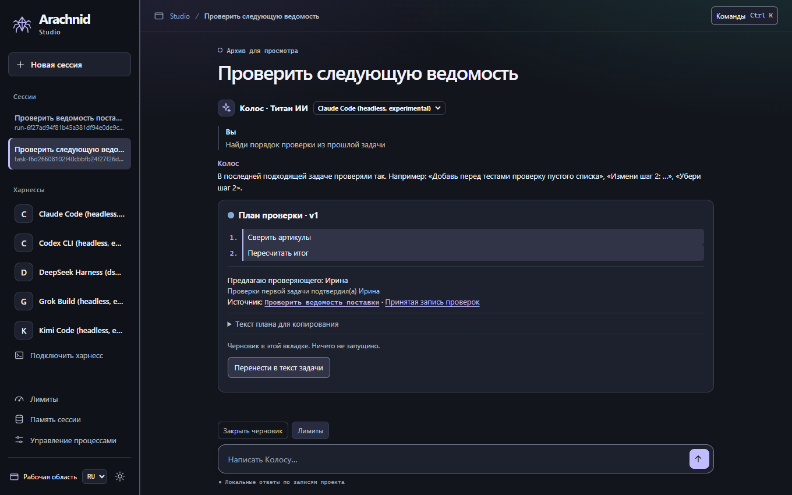
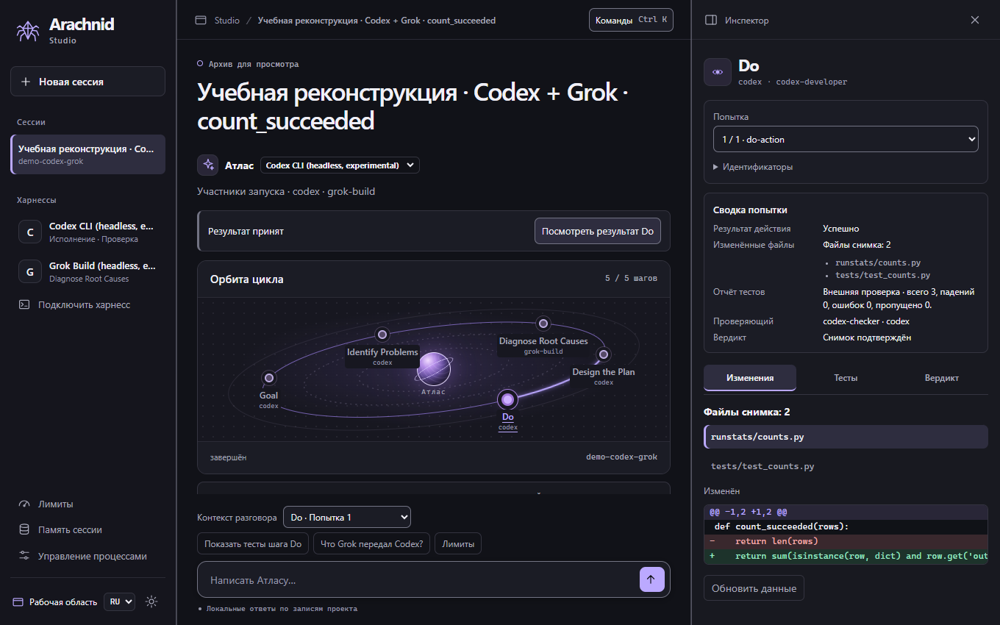

# Arachnid Studio

[Русский](README.ru.md) · [Windows downloads](https://github.com/VasilyKolbenev/agent-conductor/releases) · [Getting started](docs/first-run-v1.en.md) · [Architecture](docs/architecture.md)

Arachnid is a local workspace for coding harnesses. Describe a task to **Kolos**, choose the tools and their roles, and review the proposed limits before work begins. Follow the workflow on an orbit. Select a step to see what that participant actually produced while the conversation stays in the middle.



## Try it on Windows

The [Releases page](https://github.com/VasilyKolbenev/agent-conductor/releases) lists downloadable pilots. Open a release, download its ZIP and checksum, extract the ZIP and run the included Windows launcher. Python 3.11 or 3.12 with venv and pip is required. The notes for each pilot describe exactly what you can try offline.

| Which experience do you want? | What to open |
| --- | --- |
| Inspect a worked example with Codex and Grok | [Windows Pilot 1 and its installation guide](https://github.com/VasilyKolbenev/agent-conductor/releases/tag/v0.1.0-pilot.1). Its bundled project contains a teaching example you can inspect without signing in. |
| Carry a review procedure from one of your tasks to the next | [Two-task Windows pilot instructions](distribution/windows-two-task/START-HERE.txt). The first task records the checks and observations you confirm. In the second, ask Kolos for that procedure, open the cited record or edit the proposed plan in chat. |
| Connect your own harnesses | [First-run and account setup](docs/first-run-v1.en.md). Check the supported CLI version, sign into your own account and preview the scope before granting a run. |

The two-task pilot stores both tasks and the accepted observations locally. The edited plan stays in the open tab. Copy the plan from the task brief if you want to keep that revision. These pilot walkthroughs make no model calls.

[View the source record with both observations and the operator who accepted them](docs/assets/kolos-task-evidence.png).

## What a completed run looks like

In the accepted Windows run, Grok diagnosed a bug in `count_succeeded`. Codex patched two files. Three unittest cases ran before a separate Codex instance reviewed the result. The operator confirmed Do and accepted the final result. The inspector binds the diff, test protocol and verdict to the selected attempt. [Run report](docs/recovery/2026-10-20/tasks/DALIO-FIRST-COMPLETE-REPORT.md).



| Harness | Evidence available today |
| --- | --- |
| Codex CLI and Grok Build | Together completed the five-step subscription workflow above on Windows. |
| Claude Code | Completed a subscription Goal in isolation. Full-role acceptance remains open. |
| Kimi Code CLI | Opened a session in an offline test. A live subscription task is pending. |
| DeepSeek Harness | API-key adapter with a local test. The service uses an API balance. |
| Additional utilities | Manual CLI handoff or a compatible protocol bridge. Each utility needs its own check for automation and subscription support. |

Start with the five-step Dalio workflow or build a custom workflow in Studio. The operator grants a bounded run and takes the decisions assigned to them. [Workflow and harness setup](docs/first-run-v1.en.md) · [V2 roadmap](docs/plans/2026-11-13-v2-alpha-review.ru.md).

## Build and explore

The runtime originated as **December Command v0.1.0 alpha**. Its Python distribution is `agent-conductor` and its command is `conduct`. CI covers Windows, Linux and macOS. The downloadable colleague pilots target Windows. Use the tag next to a release to inspect the source corresponding to that ZIP. [Release evidence](docs/release-notes-v1-alpha.md) · [CI](https://github.com/VasilyKolbenev/agent-conductor/actions/workflows/ci.yml) · [Contributing](CONTRIBUTING.md) · [MIT license](LICENSE).

For a source checkout:

```sh
git clone https://github.com/VasilyKolbenev/agent-conductor.git
cd agent-conductor
python -m venv .venv
```

On Windows, run `.\.venv\Scripts\python.exe -m pip install -e .` and then `.\.venv\Scripts\conduct.exe demo`. On Linux and macOS, use `.venv/bin/python -m pip install -e .` and `.venv/bin/conduct demo`. Open the local URL printed in your terminal. Ctrl+C stops the demo.

Developers can find the versioned workflow contracts under the documentation index, `docs/index.md`.

<details>
<summary><strong>CLI reference · useful once you leave the demo</strong></summary>

Run `conduct --help`, or add `--help` to a command, for its flags.
Use the executable inside your virtual environment if it is not activated.

| Command | Purpose |
| --- | --- |
| `conduct demo` | Open the bundled sample in a temporary directory. |
| `conduct init` | Create project data; interactive terminals ask setup questions. |
| `conduct validate` | Check the map and lane files. |
| `conduct doctor` | Explain readiness problems and the next action. |
| `conduct providers` | Configure executable paths and allowed environment-variable names. |
| `conduct ownership` | Activate, inspect, or explicitly recover project ownership. |
| `conduct up` | Start local Studio for the project. |
| `conduct utility-bridge` | Deliver an attached `stdio-v1` utility's pending text to a local executable and record its reply in Studio. |
| `conduct prompt` | Print working instructions for an agent's reporting role. |
| `conduct report` | Print the merged lane state as Markdown. |
| `conduct preview` | Prepare a synthetic dispatch preview without executing it. |
| `conduct integration-smoke` | Exercise the synthetic execution road; not a live provider task. |
| `conduct reconcile` | Inspect actions left uncertain after interruption. |
| `conduct tools` | Pin the `git` and `gh` this product may run (`conduct tools pin git --path <absolute path>`). |
| `conduct hub` | Serve the hub page on one loopback port (default 7700); it runs one server per project. |
| `conduct projects add` | Check and register a local project folder using the shared harness profile. |

Project-map templates are different from Studio's workflow starters:

- **`--template NAME`** skips the `conduct init` questions and chooses a project map:
  - `default-orbit` — the default five-stage map.
  - `single-harness` — one implementing role and a human decision, without a reviewer.
  - `empty` — a minimal placeholder map.
  - `minimal` — the protocol's example map.

The bootstrap prompt follows the map: where nodes are placeholders, it tells the agent to replace them with your real components;
where nodes already name components, it tells the agent to check each one against your project instead.
`conduct init` does not overwrite existing project data. Follow [first run](docs/first-run-v1.en.md) for ownership activation.

</details>
