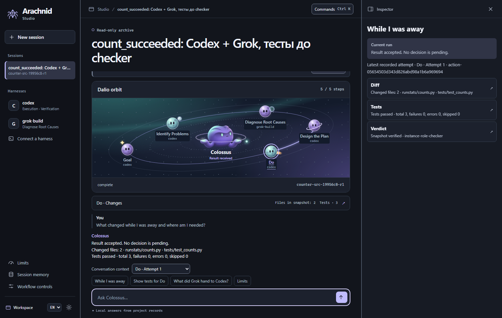
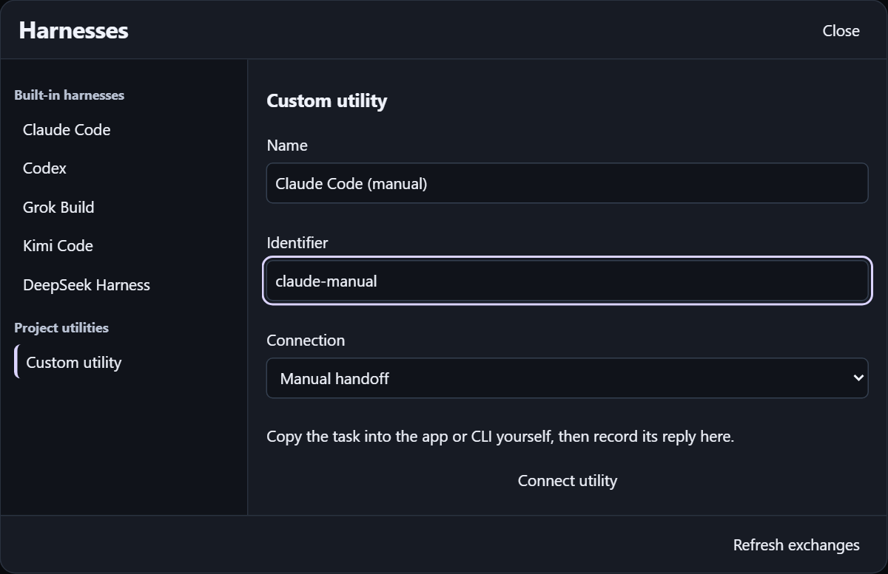
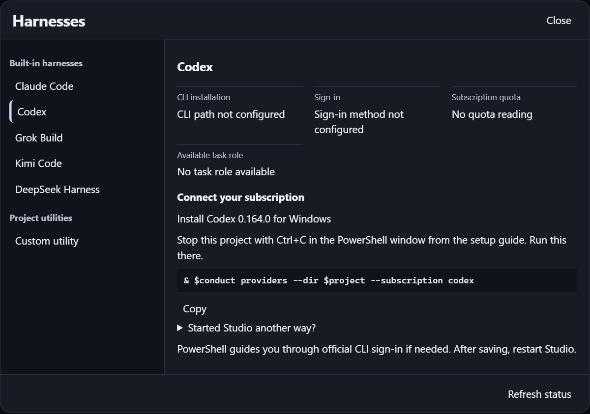
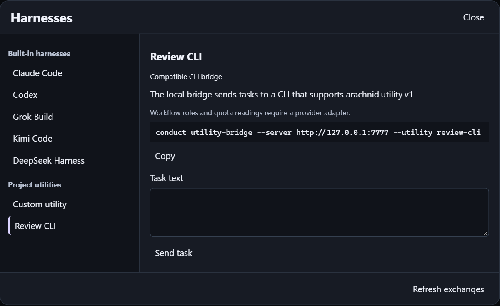

# Arachnid Studio

**Give Colossus one goal and put a team of coding harnesses to work on it.** In Arachnid Studio, one tool can investigate a problem, another can change the code, and a separate instance can review the result. Agree on roles, a budget and approval points in the local Studio. Once you start the workflow, the team passes results between steps until it reaches a decision or a limit.

[**Download Arachnid Studio**][release] · [Connect your own harness](#connect-your-own-harness) · [Русский](README.ru.md)

| Windows | Linux (tested on Ubuntu) | macOS |
| --- | --- | --- |
| Two-task ZIP, Studio and CLI. Live Codex + Grok on personal subscriptions. | Studio and CLI from the Python wheel. Local demo. | Studio and CLI from the same wheel. Local demo. |

**Inside the accepted Codex + Grok run**



On a real Windows run, Grok read the counter and its tests to diagnose why failed runs were counted as successes. Codex fixed `count_succeeded`. Three unit tests passed before a separate Codex instance reviewed the patch. The operator approved implementation and accepted the result. [Run record](https://github.com/VasilyKolbenev/agent-conductor/blob/3304810f645b0e515b95934328009f1456139c58/docs/recovery/2026-10-20/tasks/DALIO-FIRST-COMPLETE-REPORT.md).

## Run Arachnid

Use **Python 3.11 or 3.12** with `venv` and `pip`. Both walkthroughs below run locally without signing in or calling a model.

**Windows.** Download the [Studio ZIP][zip] and [SHA-256 checksum][checksum]. Extract the whole ZIP and open **`START.cmd`**. The Studio demo opens in Russian. Select **EN** at the bottom of the sidebar, then **Do** to see the changes, tests and review. To work through two tasks of your own, run `.\START.cmd new` from the extracted folder. Its terminal prompts are in Russian and accept `ACCEPT` to confirm. Record your checks on the first task and ask Colossus to find them for the second. [Walkthrough](https://github.com/VasilyKolbenev/agent-conductor/releases/download/v0.1.1/START-HERE.txt).

**Linux or macOS · explore Studio.** Download the [Python wheel][wheel]. In the folder containing that file, run the following with Python 3.12 (substitute `python3.11` if needed).

```sh
python3.12 -m venv .venv
.venv/bin/python -m pip install --no-index ./agent_conductor-0.1.1-py3-none-any.whl
.venv/bin/conduct demo
```

On Windows, the same wheel also runs the CLI demo from PowerShell. For Python 3.11, use `py -3.11` on the first line. If the `py` launcher is missing, use `python` there after checking that `python --version` reports 3.11 or 3.12.

```powershell
py -3.12 -m venv .venv
.\.venv\Scripts\python.exe -m pip install --no-index .\agent_conductor-0.1.1-py3-none-any.whl
.\.venv\Scripts\python.exe -m conductor demo
```

Open the local URL printed in the terminal. Press Ctrl+C there to stop the demo. For a real project, the setup guide covers supported CLI versions, account sign-in, isolation and the preview you approve before execution. [First real project](docs/first-run-v1.en.md).

## Work with a team of harnesses

| Ask Colossus or choose a step | What Studio shows |
| --- | --- |
| “What did Grok hand to Codex?” | The diagnosis and its supporting material from the run. |
| Select **Do**, then an attempt | The actual diff, test results and independent verdict for that attempt. |
| “What changed while I was away?” | The latest recorded outcome, any decision waiting for you, and links to the evidence. |
| “Find the review procedure from the previous task.” | A proposed sequence and reviewer, linked to the accepted record you can inspect. |

The default workflow follows Ray Dalio’s five steps. Set a goal, identify problems, diagnose the cause, design a plan and carry it out. You can also build and publish your own cycle. The roles a harness can take depend on its adapter. [Workflow setup](docs/first-run-v1.en.md) · [Evidence behind a recalled procedure](docs/assets/kolos-task-evidence.png).

| Harness | What has been verified |
| --- | --- |
| **Codex CLI + Grok Build** | A complete five-step run on Windows with the owner's subscriptions, without API keys. Codex implemented and reviewed in separate instances. |
| Claude Code | A subscription Goal produced a saved result in isolation. Identify timed out. The setup guide covers manual handoff to the official CLI. [Run record](https://github.com/VasilyKolbenev/agent-conductor/blob/3304810f645b0e515b95934328009f1456139c58/docs/recovery/2026-10-20/tasks/H5-B-RUN2-REPORT.md). |
| Kimi Code CLI | Has a quota source and passed a local session check. Subscription task execution is disabled in 0.1.1. |
| DeepSeek Harness | An API-key adapter passed local tests. The provider uses an API balance. |
| Your own CLI | Manual handoff, or two-way text exchange through a compatible local bridge. Autonomous roles and subscription support depend on the adapter. |

## Connect your own harness

Open an **active project** and choose **Connect a harness** in the left sidebar. If you opened the ZIP demo, follow the [first-project guide](docs/first-run-v1.en.md) to create a project of your own.

**Use a tool with your subscription.** Sign in to its official CLI. Choose **Custom utility → Manual handoff**, enter a name and identifier, then select **Connect utility**. The screenshot shows Claude Code. You can use the same steps with GitHub Copilot CLI or Cursor Agent if your plan includes CLI access.



Enter a task, choose **Prepare handoff → Copy**, and paste the text into the CLI. Paste its answer into **Utility reply** and select **Save reply**. Studio keeps the exchange with the project. The provider handles sign-in and usage. [Copilot CLI sign-in](https://docs.github.com/en/copilot/how-tos/copilot-cli/set-up-copilot-cli/authenticate-copilot-cli) · [Cursor CLI sign-in](https://cursor.com/docs/cli/reference/authentication).

<details>
<summary><strong>Give Codex or Grok Build an autonomous role on Windows x64</strong></summary>

Open the built-in **Codex** or **Grok Build** card. Install the indicated CLI version and copy the setup command from the card. In the project’s PowerShell window, press Ctrl+C, run the command, complete the official sign-in and save the settings. Restart Studio and check **Available task role**. In the accepted run Grok investigated the source, Codex changed it, and a separate Codex instance reviewed the patch.



**Reconnecting an existing profile in 0.1.1.** The setup wizard can stop before sign-in
with `The dedicated login contains unreviewed files.` We reproduced this with a `plugins`
directory in the dedicated Codex profile and a `bundled` directory in the dedicated Grok
profile. At that point the project has no new connection. The manual handoff above still works.

</details>

<details>
<summary><strong>Exchange text automatically with a compatible CLI</strong></summary>

If the tool speaks `arachnid.utility.v1`, select **Compatible CLI bridge**. Copy the
`conduct utility-bridge` command from its card. In a separate PowerShell window, set
`$python` and `$conduct` as shown in the [setup guide](docs/first-run-v1.en.md#4-open-studio)
and replace the leading `conduct` with `& $conduct`. On Linux or macOS, use the path to
`bin/conduct` in your environment. Keep the address and ID from the card, run the command and
supply the tool’s executable and arguments. Select **Send task**, then **Refresh exchanges** to
see the reply. The bridge carries text. Assigning workflow roles and reading quotas require a
provider adapter.



</details>

## Explore the project

[Architecture](docs/architecture.md) · [Documentation](docs/index.md) · [Contributing](CONTRIBUTING.md) · [MIT license](LICENSE)

The Python package is `agent-conductor` and the command is `conduct`. For local reading, see `docs/index.md`. [Documentation](docs/index.md).

[release]: https://github.com/VasilyKolbenev/agent-conductor/releases/tag/v0.1.1
[zip]: https://github.com/VasilyKolbenev/agent-conductor/releases/download/v0.1.1/Arachnid-Studio-Windows.zip
[checksum]: https://github.com/VasilyKolbenev/agent-conductor/releases/download/v0.1.1/Arachnid-Studio-Windows.zip.sha256
[wheel]: https://github.com/VasilyKolbenev/agent-conductor/releases/download/v0.1.1/agent_conductor-0.1.1-py3-none-any.whl

<details>
<summary><strong>CLI reference · useful once you leave the demo</strong></summary>

Run `conduct --help`, or add `--help` to a command, for its flags.
Use the executable inside your virtual environment if it is not activated.

| Command | Purpose |
| --- | --- |
| `conduct demo` | Open the bundled sample in a temporary directory. |
| `conduct init` | Create project data; interactive terminals ask setup questions. |
| `conduct validate` | Check the map and lane files. |
| `conduct doctor` | Explain readiness problems and the next action. |
| `conduct providers` | Configure executable paths and allowed environment-variable names. |
| `conduct ownership` | Activate, inspect, or explicitly recover project ownership. |
| `conduct up` | Start local Studio for the project. |
| `conduct utility-bridge` | Deliver an attached `stdio-v1` utility's pending text to a local executable and record its reply in Studio. |
| `conduct prompt` | Print working instructions for an agent's reporting role. |
| `conduct report` | Print the merged lane state as Markdown. |
| `conduct preview` | Prepare a synthetic dispatch preview without executing it. |
| `conduct integration-smoke` | Exercise the synthetic execution road; not a live provider task. |
| `conduct reconcile` | Inspect actions left uncertain after interruption. |
| `conduct tools` | Pin the `git` and `gh` this product may run (`conduct tools pin git --path <absolute path>`). |
| `conduct hub` | Serve the hub page on one loopback port (default 7700); it runs one server per project. |
| `conduct projects add` | Check and register a local project folder using the shared harness profile. |

Project-map templates are different from Studio's workflow starters:

- **`--template NAME`** skips the `conduct init` questions and chooses a project map:
  - `default-orbit` — the default five-stage map.
  - `single-harness` — one implementing role and a human decision, without a reviewer.
  - `empty` — a minimal placeholder map.
  - `minimal` — the protocol's example map.

The bootstrap prompt follows the map: where nodes are placeholders, it tells the agent to replace them with your real components;
where nodes already name components, it tells the agent to check each one against your project instead.
`conduct init` does not overwrite existing project data. Follow [first run](docs/first-run-v1.en.md) for ownership activation.

</details>
