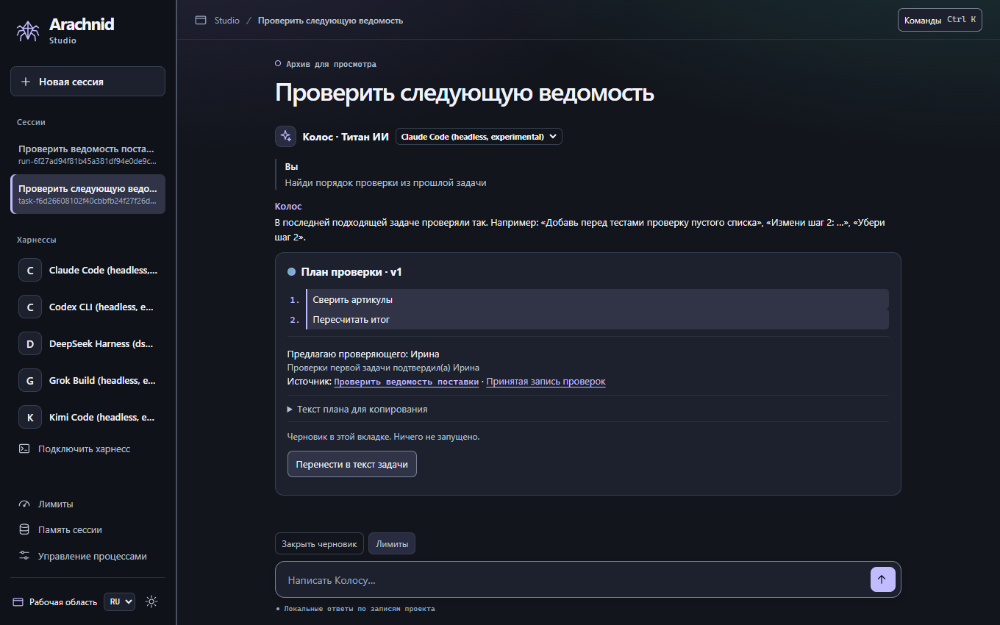
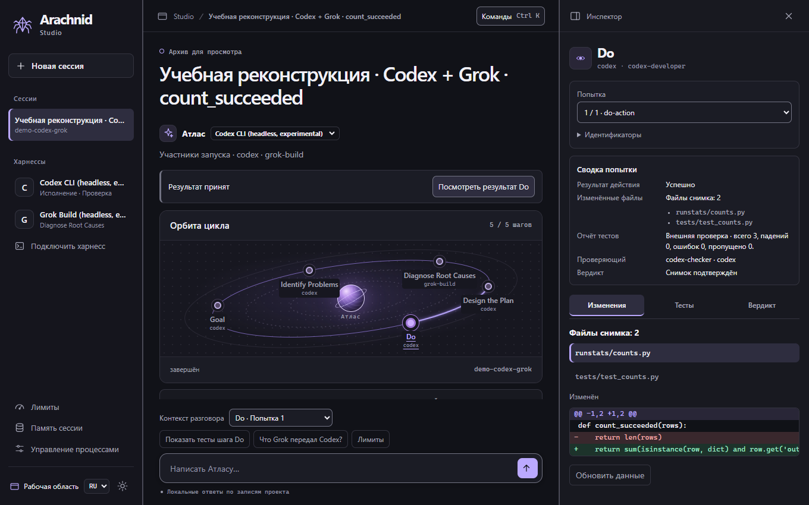

# Arachnid Studio

[English](README.md) · [Скачать пилот для Windows](https://github.com/VasilyKolbenev/agent-conductor/releases) · [Первый запуск](docs/first-run-v1.md) · [Архитектура](docs/architecture.ru.md)

Arachnid объединяет несколько харнессов в одном локальном рабочем пространстве. Опишите задачу **Колосу**, назначьте инструменты на роли и проверьте условия перед запуском. На орбите виден ход работы. Выберите шаг, чтобы открыть материалы участника справа и продолжить разговор в центре.



## Как попробовать на Windows

Откройте [релизы на GitHub](https://github.com/VasilyKolbenev/agent-conductor/releases), скачайте ZIP выбранного пилота и его контрольную сумму. Распакуйте архив и откройте файл запуска по инструкции внутри. Понадобится Python 3.11 или 3.12 с venv и pip.

| Что хочется попробовать | С чего начать |
| --- | --- |
| Разобрать пример работы Codex и Grok | [Windows Pilot 1 и инструкция](https://github.com/VasilyKolbenev/agent-conductor/releases/tag/v0.1.0-pilot.1). В комплект входит учебный проект, который можно открыть без входа в подписки. |
| Перенести опыт из одной своей задачи в другую | [Инструкция пилота на двух задачах](distribution/windows-two-task/START-HERE.txt). Для первой вы записываете выполненные проверки и наблюдения. Во второй просите Колоса найти порядок, открываете исходную запись и меняете план прямо в чате. |
| Подключить собственные харнессы | [Первый запуск и настройка аккаунтов](docs/first-run-v1.md). Проверьте версию CLI, войдите в свой аккаунт и просмотрите границы запуска перед разрешением. |

Оба офлайн-сценария обходятся без вызовов моделей. В пилоте на двух задачах сами задачи и принятая запись сохраняются на вашем компьютере. Отредактированный план живёт в открытой вкладке. Чтобы оставить себе эту версию, скопируйте её из текста задачи.

[Посмотреть исходную запись с двумя наблюдениями и именем принявшего их оператора](docs/assets/kolos-task-evidence.png).

## Как выглядит принятый результат

В принятом запуске на Windows Grok нашёл причину ошибки в `count_succeeded`. Codex изменил два файла. До независимого ревью прошли три теста unittest. Другой экземпляр Codex проверил результат, а оператор подтвердил Do и финальную приёмку. Выбор попытки в Studio открывает её diff, протокол и вердикт. [Отчёт о запуске](docs/recovery/2026-10-20/tasks/DALIO-FIRST-COMPLETE-REPORT.md).



| Харнесс | Что проверено |
| --- | --- |
| Codex CLI и Grok Build | Вдвоём прошли пятишаговый цикл по подпискам на Windows. |
| Claude Code | Выполнил Goal по подписке в изоляции. Приёмка полной роли ещё впереди. |
| Kimi Code CLI | Открыл сессию в офлайн-тесте. Живая задача по подписке ожидает проверки. |
| DeepSeek Harness | Адаптер с API-ключом проверен локально. Сервис использует баланс API. |
| Другие утилиты | Есть ручная передача через CLI и мост для совместимого протокола. Автоматизацию и доступ по подписке проверяем отдельно для каждой утилиты. |

Можно начать с пяти шагов Далио или собрать свой цикл в Studio. Оператор задаёт пределы работы и принимает решения на выбранных этапах. [Настройка цикла и харнессов](docs/first-run-v1.md) · [Что запланировано в V2](docs/plans/2026-11-13-v2-alpha-review.ru.md).

## Для разработчиков

Прежнее название проекта — December Command. Для совместимости пакет версии 0.1.0 называется `agent-conductor`, команда — `conduct`. CI охватывает Windows, Linux и macOS. Пакеты для коллег собраны для Windows. Чтобы изучить точные исходники пилота, откройте тег на странице его релиза. [Состояние приёмки](docs/release-notes-v1-alpha.ru.md) · [Проверки CI](https://github.com/VasilyKolbenev/agent-conductor/actions/workflows/ci.yml) · [Как внести вклад](CONTRIBUTING.ru.md) · [Лицензия MIT](LICENSE).

Для запуска из исходников:

```sh
git clone https://github.com/VasilyKolbenev/agent-conductor.git
cd agent-conductor
python -m venv .venv
```

В Windows выполните `.\.venv\Scripts\python.exe -m pip install -e .`, затем `.\.venv\Scripts\conduct.exe demo`. В Linux и macOS используйте `.venv/bin/python -m pip install -e .` и `.venv/bin/conduct demo`. Откройте локальный адрес из терминала. Ctrl+C остановит демо.

Оглавление документации для локального просмотра находится в `docs/index.ru.md`.

<details>
<summary><strong>Команды · пригодятся после демо</strong></summary>

Список параметров показывает `conduct --help` или `--help` у нужной команды.
Если окружение не активировано, используйте полный путь к команде внутри `.venv`.

| Команда | Назначение |
| --- | --- |
| `conduct demo` | Открыть пример во временной папке. |
| `conduct init` | Создать данные проекта; в интерактивном терминале задать вопросы настройки. |
| `conduct validate` | Проверить карту и файлы отчётности агентов. |
| `conduct doctor` | Объяснить, что мешает работе и что сделать дальше. |
| `conduct providers` | Настроить пути к инструментам и разрешённые имена переменных окружения. |
| `conduct ownership` | Активировать, проверить или явно восстановить владение проектом. |
| `conduct up` | Запустить локальный Studio для проекта. |
| `conduct prompt` | Напечатать инструкцию для отчётности агента в выбранной роли. |
| `conduct report` | Напечатать объединённые отчёты агентов в Markdown. |
| `conduct preview` | Подготовить синтетический предпросмотр без исполнения. |
| `conduct integration-smoke` | Пройти синтетическую проверку исполнения, без настоящей задачи провайдера. |
| `conduct reconcile` | Найти действия с неопределённым исходом после прерывания. |
| `conduct tools` | Закрепить версии `git` и `gh`, которые использует продукт. |
| `conduct hub` | Открыть общую страницу проектов; порт по умолчанию — 7700. |
| `conduct projects add` | Проверить и добавить папку проекта с общим профилем харнессов. |
| `conduct utility-bridge` | Передать текст задачи подключённой утилите `stdio-v1` и сохранить её ответ в Studio. |

Шаблоны карты проекта отличаются от стартовых процессов Studio:

- **`--template NAME`** пропускает вопросы `conduct init` и выбирает карту:
  - `default-orbit` — стандартная карта из пяти стадий.
  - `single-harness` — роль исполнителя и решение человека, без проверяющего.
  - `empty` — минимальная карта с заготовкой узла.
  - `minimal` — пример карты из протокола.

Начальная инструкция предлагает заменить узлы-заготовки реальными компонентами проекта;
если компоненты уже заданы, предлагает проверить их соответствие проекту.
`conduct init` не перезаписывает существующие данные. Активация владения описана в [первом запуске](docs/first-run-v1.md).

</details>
