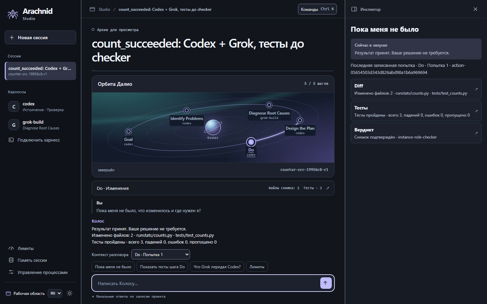

# Arachnid Studio

**Локальная студия, в которой несколько ИИ-инструментов передают друг другу задачу и показывают, как её решили.** Опишите цель Колоссу, согласуйте роли и лимиты, следите за ходом работы на орбите. Выберите попытку, чтобы увидеть изменения, тесты и вердикт проверяющего. Чат остаётся перед вами.

[**Скачать Arachnid Studio**][release] · [Подключить свои инструменты](docs/first-run-v1.md) · [English](README.md)

| Windows | Linux (проверено на Ubuntu) | macOS |
| --- | --- | --- |
| ZIP с двумя задачами, Studio и CLI. Живой цикл Codex + Grok по личным подпискам. | Studio и CLI из Python-пакета. Локальное демо. | Studio и CLI из того же пакета. Локальное демо. |



В реальном запуске на Windows Grok изучил реализацию счётчика и тесты и нашёл, почему сбои попадали в число успешных запусков. Codex исправил `count_succeeded`. Три теста прошли, затем другой экземпляр Codex проверил правку. Оператор одобрил исполнение и принял результат. [Отчёт о запуске](docs/recovery/2026-10-20/tasks/DALIO-FIRST-COMPLETE-REPORT.md).

## Запустить Arachnid

Понадобится **Python 3.11 или 3.12** с `venv` и `pip`. Оба сценария ниже работают локально, без входа в аккаунты и вызовов моделей.

**Windows · две ваши задачи.** Скачайте [архив для Windows][zip] и [файл с контрольной суммой SHA-256][checksum]. Полностью распакуйте архив и откройте **`START.cmd`**. Вспомните завершённую задачу и запишите, что проверили. Во второй попросите Колосса найти этот порядок, откройте источник и поправьте план проверки в чате. Обе задачи и принятые наблюдения сохраняются на компьютере. Черновик изменённого плана можно скопировать до закрытия вкладки. [Пошаговая инструкция](https://github.com/VasilyKolbenev/agent-conductor/releases/download/v0.1.0-pilot.3/START-HERE.txt).

**Linux и macOS · знакомство со Studio.** Скачайте [Python-пакет wheel][wheel]. В папке со скачанным файлом выполните команды для Python 3.12. Если установлен Python 3.11, в первой строке используйте `python3.11`.

```sh
python3.12 -m venv .venv
.venv/bin/python -m pip install --no-index ./agent_conductor-0.1.0-py3-none-any.whl
.venv/bin/conduct demo
```

В Windows тот же пакет позволяет открыть демо из PowerShell. Для Python 3.11 используйте `py -3.11` в первой строке.

```powershell
py -3.12 -m venv .venv
.\.venv\Scripts\python.exe -m pip install --no-index .\agent_conductor-0.1.0-py3-none-any.whl
.\.venv\Scripts\python.exe -m conductor demo
```

Откройте локальный адрес, который появится в терминале. Чтобы остановить демо, нажмите там Ctrl+C. Для своего проекта настройте поддерживаемые версии CLI, войдите в подписки и просмотрите условия запуска в Studio. [Первый реальный проект](docs/first-run-v1.md).

## Что видно во время работы

| Спросите Колосса или выберите шаг | Что откроет Studio |
| --- | --- |
| «Что Grok передал Codex?» | Диагноз и материалы запуска, на которые он опирается. |
| Выберите **Do**, затем попытку | Фактические изменения файлов, результаты тестов и вердикт независимого проверяющего по этой попытке. |
| «Что изменилось, пока меня не было?» | Последний записанный результат, решения, которые ждут вас, и ссылки на подтверждения. |
| «Найди порядок проверки из прошлой задачи» | Предложенный план и проверяющего со ссылкой на исходную принятую запись. |

Можно начать с пяти шагов Далио или собрать и опубликовать свой цикл. Назначьте роли, проверьте бюджет и выберите этапы, на которых требуется ваше решение. [Настройка цикла](docs/first-run-v1.md) · [Пример исходной записи о проверках](docs/assets/kolos-task-evidence.png).

| Харнесс | Что проверено |
| --- | --- |
| **Codex CLI + Grok Build** | Полный цикл из пяти шагов на Windows по подпискам владельца, без API-ключей. Исполнение и независимая проверка прошли в разных экземплярах Codex. |
| Claude Code | Шаг Goal выполнен по подписке в изоляции. Приёмка полной роли ещё впереди. |
| Kimi Code CLI | Проверено открытие сессии в офлайн-тесте. Предстоит живая задача по подписке. |
| DeepSeek Harness | Адаптер с API-ключом прошёл локальные тесты. Сервис использует баланс API. |
| Своя CLI | Ручная передача или двусторонний обмен текстом через совместимый локальный мост. Автономная роль и работа по подписке зависят от адаптера. |

## О проекте

[Архитектура](docs/architecture.ru.md) · [Планы V2](docs/plans/2026-11-13-v2-alpha-review.ru.md) · [Участие в разработке](CONTRIBUTING.ru.md) · [Лицензия MIT](LICENSE)

Прежнее название проекта — December Command. Python-пакет называется `agent-conductor`, команда — `conduct`. Оглавление документации для локального просмотра находится в `docs/index.ru.md`. [Состояние приёмки](docs/release-notes-v1-alpha.ru.md) · [Проверки сборки](https://github.com/VasilyKolbenev/agent-conductor/actions/runs/43869073662).

Предыдущие выпуски позволяют [разобрать офлайн-пример Codex + Grok в Pilot 1](https://github.com/VasilyKolbenev/agent-conductor/releases/tag/v0.1.0-pilot.1) и [открыть первый пилот с двумя своими задачами](https://github.com/VasilyKolbenev/agent-conductor/releases/tag/v0.1.0-pilot.2).

[release]: https://github.com/VasilyKolbenev/agent-conductor/releases/tag/v0.1.0-pilot.3
[zip]: https://github.com/VasilyKolbenev/agent-conductor/releases/download/v0.1.0-pilot.3/Arachnid-Windows-Pilot-3.zip
[checksum]: https://github.com/VasilyKolbenev/agent-conductor/releases/download/v0.1.0-pilot.3/Arachnid-Windows-Pilot-3.zip.sha256
[wheel]: https://github.com/VasilyKolbenev/agent-conductor/releases/download/v0.1.0-pilot.3/agent_conductor-0.1.0-py3-none-any.whl

<details>
<summary><strong>Команды · пригодятся после демо</strong></summary>

Список параметров показывает `conduct --help` или `--help` у нужной команды.
Если окружение не активировано, используйте полный путь к команде внутри `.venv`.

| Команда | Назначение |
| --- | --- |
| `conduct demo` | Открыть пример во временной папке. |
| `conduct init` | Создать данные проекта; в интерактивном терминале задать вопросы настройки. |
| `conduct validate` | Проверить карту и файлы отчётности агентов. |
| `conduct doctor` | Объяснить, что мешает работе и что сделать дальше. |
| `conduct providers` | Настроить пути к инструментам и разрешённые имена переменных окружения. |
| `conduct ownership` | Активировать, проверить или явно восстановить владение проектом. |
| `conduct up` | Запустить локальный Studio для проекта. |
| `conduct prompt` | Напечатать инструкцию для отчётности агента в выбранной роли. |
| `conduct report` | Напечатать объединённые отчёты агентов в Markdown. |
| `conduct preview` | Подготовить синтетический предпросмотр без исполнения. |
| `conduct integration-smoke` | Пройти синтетическую проверку исполнения, без настоящей задачи провайдера. |
| `conduct reconcile` | Найти действия с неопределённым исходом после прерывания. |
| `conduct tools` | Закрепить версии `git` и `gh`, которые использует продукт. |
| `conduct hub` | Открыть общую страницу проектов; порт по умолчанию — 7700. |
| `conduct projects add` | Проверить и добавить папку проекта с общим профилем харнессов. |
| `conduct utility-bridge` | Передать текст задачи подключённой утилите `stdio-v1` и сохранить её ответ в Studio. |

Шаблоны карты проекта отличаются от стартовых процессов Studio:

- **`--template NAME`** пропускает вопросы `conduct init` и выбирает карту:
  - `default-orbit` — стандартная карта из пяти стадий.
  - `single-harness` — роль исполнителя и решение человека, без проверяющего.
  - `empty` — минимальная карта с заготовкой узла.
  - `minimal` — пример карты из протокола.

Начальная инструкция предлагает заменить узлы-заготовки реальными компонентами проекта;
если компоненты уже заданы, предлагает проверить их соответствие проекту.
`conduct init` не перезаписывает существующие данные. Активация владения описана в [первом запуске](docs/first-run-v1.md).

</details>
