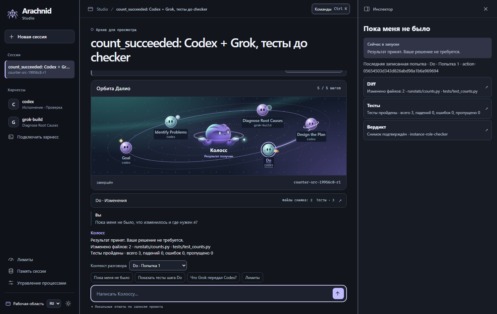
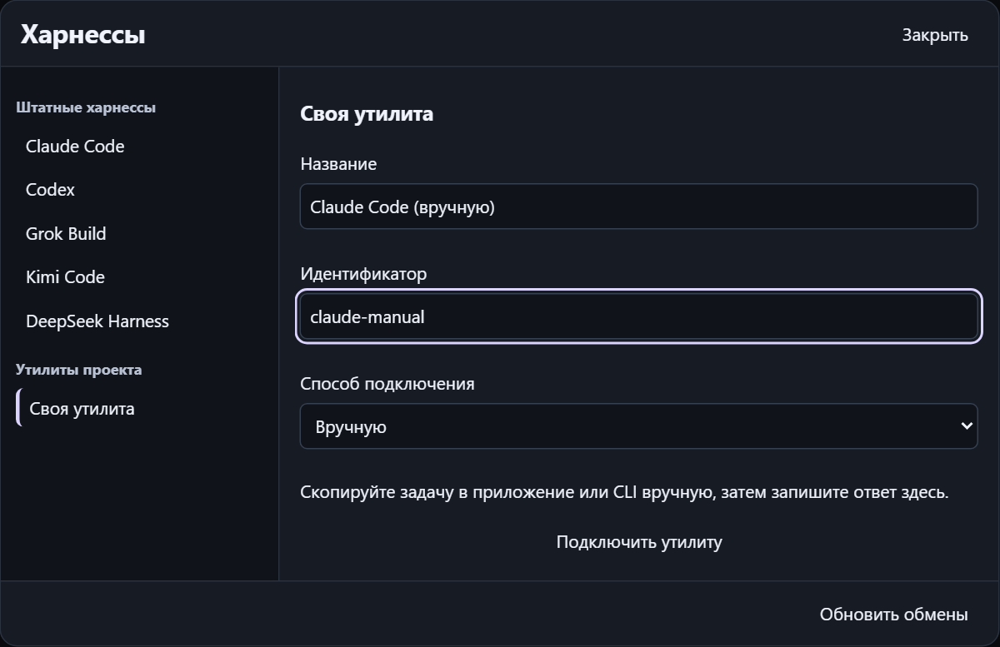
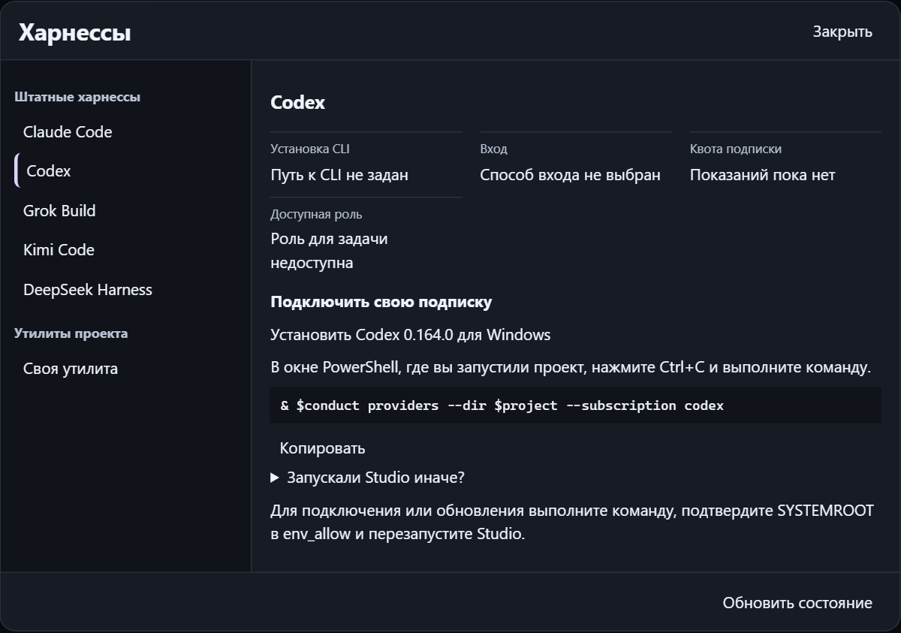
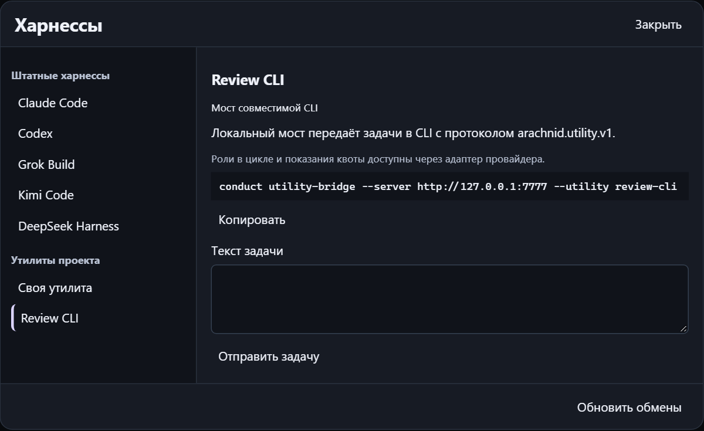

# Arachnid Studio

**Поставьте одну цель Колоссу и соберите для неё команду ИИ-харнессов.** В Arachnid Studio один инструмент может исследовать проблему, другой — исправить код, а отдельный экземпляр — проверить результат. Вы согласуете роли, бюджет и этапы, где нужно ваше решение. После старта команда сама передаёт результаты между шагами, пока не дойдёт до такого этапа или до лимита.

[**Скачать Arachnid Studio**][release] · [Как подключить свой харнесс](#подключить-свой-харнесс) · [English](README.md)

| Windows | Linux (проверено на Ubuntu) | macOS |
| --- | --- | --- |
| ZIP с двумя задачами, Studio и CLI. Живой цикл Codex + Grok по личным подпискам. | Studio и CLI из Python-пакета. Локальное демо. | Studio и CLI из того же пакета. Локальное демо. |

**Орбита принятого запуска Codex + Grok**



В реальном запуске на Windows Grok изучил реализацию счётчика и тесты и нашёл, почему сбои попадали в число успешных запусков. Codex исправил `count_succeeded`. Три теста прошли, затем другой экземпляр Codex проверил правку. Оператор одобрил исполнение и принял результат. [Отчёт о запуске](https://github.com/VasilyKolbenev/agent-conductor/blob/3304810f645b0e515b95934328009f1456139c58/docs/recovery/2026-10-20/tasks/DALIO-FIRST-COMPLETE-REPORT.md).

## Запустить Arachnid

Понадобится **Python 3.11 или 3.12** с `venv` и `pip`. Оба сценария ниже работают локально, без входа в аккаунты и вызовов моделей.

**Windows.** Скачайте [архив Studio][zip] и [контрольную сумму SHA-256][checksum]. Распакуйте архив целиком и откройте **`START.cmd`**. При первом запуске откроется учебный пример Codex + Grok. Выберите **Do**, чтобы увидеть изменения, тесты и вердикт. Для своих двух задач запустите `.\START.cmd new` в папке приложения. Запишите проверки первой задачи и попросите Колосса найти их для второй. [Инструкция](https://github.com/VasilyKolbenev/agent-conductor/releases/download/v0.1.1/START-HERE.txt).

**Linux и macOS · знакомство со Studio.** Скачайте [Python-пакет wheel][wheel]. В папке со скачанным файлом выполните команды для Python 3.12. Если установлен Python 3.11, в первой строке используйте `python3.11`.

```sh
python3.12 -m venv .venv
.venv/bin/python -m pip install --no-index ./agent_conductor-0.1.1-py3-none-any.whl
.venv/bin/conduct demo
```

В Windows тот же пакет позволяет открыть демо из PowerShell. Для Python 3.11 используйте `py -3.11` в первой строке. Если команда `py` отсутствует, выполните `python --version`. Если это 3.11 или 3.12, используйте `python` в первой строке.

```powershell
py -3.12 -m venv .venv
.\.venv\Scripts\python.exe -m pip install --no-index .\agent_conductor-0.1.1-py3-none-any.whl
.\.venv\Scripts\python.exe -m conductor demo
```

Откройте локальный адрес, который появится в терминале. Чтобы остановить демо, нажмите там Ctrl+C. Для своего проекта настройте поддерживаемые версии CLI, войдите в подписки и просмотрите условия запуска в Studio. [Первый реальный проект](docs/first-run-v1.md).

## Что видно во время работы

| Спросите Колосса или выберите шаг | Что откроет Studio |
| --- | --- |
| «Что Grok передал Codex?» | Диагноз и материалы запуска, на которые он опирается. |
| Выберите **Do**, затем попытку | Фактические изменения файлов, результаты тестов и вердикт независимого проверяющего по этой попытке. |
| «Что изменилось, пока меня не было?» | Последний записанный результат, решения, которые ждут вас, и ссылки на подтверждения. |
| «Найди порядок проверки из прошлой задачи» | Предложенный план и проверяющего со ссылкой на исходную принятую запись. |

По умолчанию команда проходит пять шагов Рэя Далио: ставит цель, выявляет проблемы, находит причину, составляет план и выполняет его. Можно собрать и опубликовать свой цикл. Доступные роли зависят от адаптера харнесса. [Настройка цикла](docs/first-run-v1.md) · [Пример исходной записи о проверках](docs/assets/kolos-task-evidence.png).

| Харнесс | Что проверено |
| --- | --- |
| **Codex CLI + Grok Build** | Полный цикл из пяти шагов на Windows по подпискам владельца, без API-ключей. Исполнение и независимая проверка прошли в разных экземплярах Codex. |
| Claude Code | В изоляции по подписке выполнен Goal и сохранён результат. Identify остановился по таймауту. В инструкции описана ручная передача в официальный CLI. [Отчёт запуска](https://github.com/VasilyKolbenev/agent-conductor/blob/3304810f645b0e515b95934328009f1456139c58/docs/recovery/2026-10-20/tasks/H5-B-RUN2-REPORT.md). |
| Kimi Code CLI | Есть источник показаний квоты. Сессия проверена локально. Подписочные задачи в 0.1.1 отключены. |
| DeepSeek Harness | Адаптер с API-ключом прошёл локальные тесты. Сервис использует баланс API. |
| Своя CLI | Ручная передача или двусторонний обмен текстом через совместимый локальный мост. Автономная роль и работа по подписке зависят от адаптера. |

## Подключить свой харнесс

Откройте **активный проект** и нажмите **Подключить харнесс** слева. Если вы только что открыли демо из ZIP, сначала создайте свой проект по [инструкции для первого запуска](docs/first-run-v1.md).

**Своя утилита по подписке.** Войдите в официальный CLI под своим аккаунтом. Выберите **Своя утилита → Вручную**, введите название и идентификатор, затем нажмите **Подключить утилиту**. На снимке показан Claude Code. Так же можно передавать текст в GitHub Copilot CLI или Cursor Agent, если ваш тариф даёт доступ к CLI.



Введите задачу → **Подготовить передачу** → **Копировать**. Вставьте её в CLI. Верните результат в поле **Ответ утилиты** и нажмите **Записать ответ**. Studio сохранит обмен в проекте. Вход и учёт расхода остаются у поставщика. [Вход в Copilot CLI](https://docs.github.com/en/copilot/how-tos/copilot-cli/set-up-copilot-cli/authenticate-copilot-cli) · [Вход в Cursor CLI](https://cursor.com/docs/cli/reference/authentication).

<details>
<summary><strong>Автономная роль по подписке — Codex и Grok Build на Windows x64</strong></summary>

Выберите встроенную карточку **Codex** или **Grok Build**. Установите указанную версию CLI и скопируйте команду из карточки. В окне PowerShell проекта нажмите Ctrl+C, выполните команду, пройдите штатный вход и сохраните настройки. Снова запустите Studio и проверьте строку **Доступная роль**. В принятом цикле Grok исследовал исходники, Codex внёс правку, отдельный экземпляр Codex проверил результат.



</details>

<details>
<summary><strong>Автоматический обмен текстом с совместимой CLI</strong></summary>

Если утилита поддерживает протокол `arachnid.utility.v1`, выберите **Мост совместимой CLI**.
Скопируйте команду `conduct utility-bridge` из карточки. В отдельном PowerShell восстановите
`$python` и `$conduct` по [инструкции](docs/first-run-v1.md#4-откройте-studio) и замените
начальное `conduct` на `& $conduct`. На Linux и macOS используйте путь к `bin/conduct` своего
окружения. Оставьте адрес и идентификатор из карточки, выполните команду и укажите путь к утилите
и её аргументы. В Studio нажмите **Отправить задачу**, затем **Обновить обмены**, чтобы прочитать
ответ. Мост передаёт текст. Для назначения ролей в цикле и чтения квот нужен адаптер провайдера.



</details>

## О проекте

[Архитектура](docs/architecture.ru.md) · [Документация](docs/index.ru.md) · [Участие в разработке](CONTRIBUTING.ru.md) · [Лицензия MIT](LICENSE)

Python-пакет называется `agent-conductor`, команда — `conduct`. Оглавление для локального просмотра находится в `docs/index.ru.md`. [Документация](docs/index.ru.md).

[release]: https://github.com/VasilyKolbenev/agent-conductor/releases/tag/v0.1.1
[zip]: https://github.com/VasilyKolbenev/agent-conductor/releases/download/v0.1.1/Arachnid-Studio-Windows.zip
[checksum]: https://github.com/VasilyKolbenev/agent-conductor/releases/download/v0.1.1/Arachnid-Studio-Windows.zip.sha256
[wheel]: https://github.com/VasilyKolbenev/agent-conductor/releases/download/v0.1.1/agent_conductor-0.1.1-py3-none-any.whl

<details>
<summary><strong>Команды · пригодятся после демо</strong></summary>

Список параметров показывает `conduct --help` или `--help` у нужной команды.
Если окружение не активировано, используйте полный путь к команде внутри `.venv`.

| Команда | Назначение |
| --- | --- |
| `conduct demo` | Открыть пример во временной папке. |
| `conduct init` | Создать данные проекта; в интерактивном терминале задать вопросы настройки. |
| `conduct validate` | Проверить карту и файлы отчётности агентов. |
| `conduct doctor` | Объяснить, что мешает работе и что сделать дальше. |
| `conduct providers` | Настроить пути к инструментам и разрешённые имена переменных окружения. |
| `conduct ownership` | Активировать, проверить или явно восстановить владение проектом. |
| `conduct up` | Запустить локальный Studio для проекта. |
| `conduct prompt` | Напечатать инструкцию для отчётности агента в выбранной роли. |
| `conduct report` | Напечатать объединённые отчёты агентов в Markdown. |
| `conduct preview` | Подготовить синтетический предпросмотр без исполнения. |
| `conduct integration-smoke` | Пройти синтетическую проверку исполнения, без настоящей задачи провайдера. |
| `conduct reconcile` | Найти действия с неопределённым исходом после прерывания. |
| `conduct tools` | Закрепить версии `git` и `gh`, которые использует продукт. |
| `conduct hub` | Открыть общую страницу проектов; порт по умолчанию — 7700. |
| `conduct projects add` | Проверить и добавить папку проекта с общим профилем харнессов. |
| `conduct utility-bridge` | Передать текст задачи подключённой утилите `stdio-v1` и сохранить её ответ в Studio. |

Шаблоны карты проекта отличаются от стартовых процессов Studio:

- **`--template NAME`** пропускает вопросы `conduct init` и выбирает карту:
  - `default-orbit` — стандартная карта из пяти стадий.
  - `single-harness` — роль исполнителя и решение человека, без проверяющего.
  - `empty` — минимальная карта с заготовкой узла.
  - `minimal` — пример карты из протокола.

Начальная инструкция предлагает заменить узлы-заготовки реальными компонентами проекта;
если компоненты уже заданы, предлагает проверить их соответствие проекту.
`conduct init` не перезаписывает существующие данные. Активация владения описана в [первом запуске](docs/first-run-v1.md).

</details>
