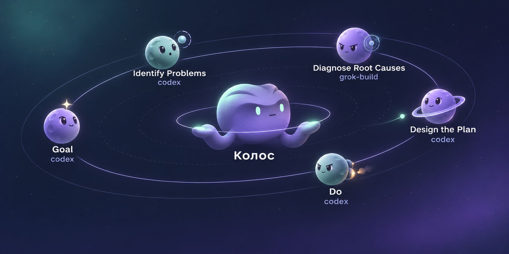

# Colossus orbit · Орбита Колосса

**Original artwork / Исходный макет, 16 ноября 2026.** [See the orbit in the installed Studio / Орбита в установленной Studio](../studio-orbit-ru.png).

| State / Состояние | What it represents / Что должно происходить в попытке |
| --- | --- |
| [Waiting / Ждёт](kolos-states/01-waiting.png) | Waiting for a decision or next action · Ожидается решение или следующее действие. |
| [Thinking / Думает](kolos-states/02-thinking.png) | The lead harness is working · Ведущий харнесс начал работу над запросом. |
| [Sending a task / Передаёт задачу](kolos-states/03-sending-task.png) | Handoff to the named harness · Задача передана указанному исполнителю. |
| [Receiving a result / Принимает результат](kolos-states/04-receiving-result.png) | This attempt has returned a result · Записан результат выбранной попытки. |

Receiving a result and accepting it are separate events. Полученный результат можно открыть и проверить. Вердикт проверяющего и решение оператора видны по собственным записям.
