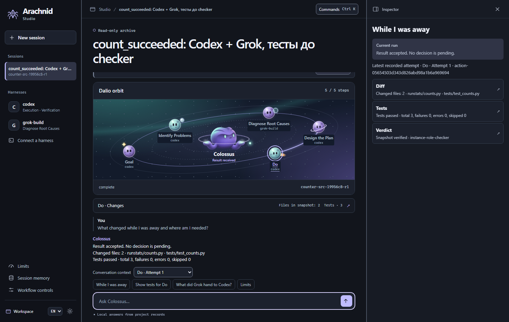

# Would you accept this change?

[Русский](run-example.ru.md) · [Back to Studio](../README.md)

You asked for a fix to a counter that reports successful runs. Now you have to decide whether to
accept the work. Here is the evidence from a completed Windows run with Codex and Grok.
You can read it here without installing Studio or signing in.

**What Grok found.** The function returned the length of its input. Given four records with
two successes, the old code still returned four.

**What Codex changed.** After the operator approved the plan, Codex edited `runstats/counts.py`
and added checks in `tests/test_counts.py`. The function now counts only dictionaries whose
`outcome` exactly matches the string `succeeded`. [Inspect the patch][patch]

| Test case | Expected | Old code would return |
| --- | ---: | ---: |
| Empty input | 0 | 0 |
| Four records, two successful | 2 | 4 |
| Nine inputs, one exact type and value match | 1 | 9 |

**What was verified.** Studio ran the three tests after applying the patch. The log records
`ok` for each one. The last column above is calculated from the old implementation.
A separate Codex instance then reviewed the saved patch and recorded a `verified` verdict.
The operator gave final approval. [Test and review record][review] · [Acceptance record][accept]

**Explore it in Studio.** The [Windows ZIP](../README.md#run-arachnid) opens an offline
reconstruction of this example. Select **Do** to see its results on the right.
To work on your own code, [set up a live project](first-run-v1.en.md).

[patch]: ../tests/fixtures/atlas-accepted-native.json
[review]: https://github.com/VasilyKolbenev/agent-conductor/blob/3304810f645b0e515b95934328009f1456139c58/docs/recovery/2026-10-20/tasks/DO-UNITTEST-RUN1-REPORT.md
[accept]: https://github.com/VasilyKolbenev/agent-conductor/blob/3304810f645b0e515b95934328009f1456139c58/docs/recovery/2026-10-20/tasks/DALIO-FIRST-COMPLETE-REPORT.md
