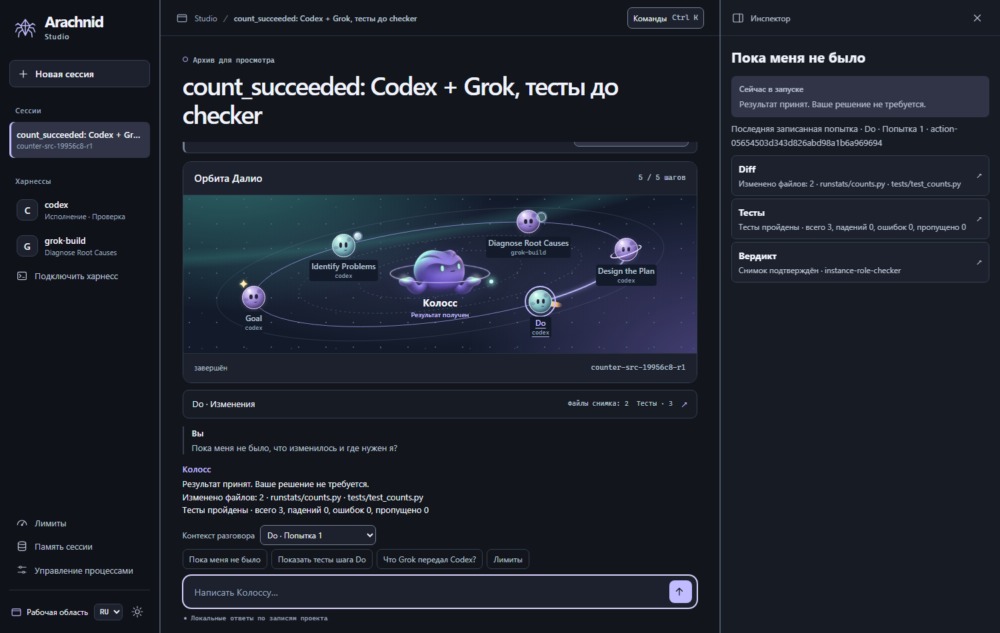

# Можно ли принять эту правку?

[English](run-example.en.md) · [Обратно к Studio](../README.ru.md)

Вы поручили исправить счётчик успешных запусков. Теперь нужно решить, принимать ли работу.
Вот на чём основали решение в завершённом запуске Codex и Grok на Windows.
Этот пример можно прочитать прямо здесь, без установки и подписок.

**Что нашли.** Grok изучил реализацию и тесты. Функция возвращала длину списка.
Если из четырёх записей успешны две, старый код всё равно возвращал четыре.

**Что изменили.** После одобрения плана Codex изменил `runstats/counts.py`
и добавил проверки в `tests/test_counts.py`. Новая функция учитывает только словари,
в которых поле `outcome` в точности равно строке `succeeded`. [Открыть diff][patch]

| Что проверяет тест | Ожидается | Старый код дал бы |
| --- | ---: | ---: |
| Пустой список | 0 | 0 |
| Четыре записи, из них две успешные | 2 | 4 |
| Девять элементов, один точно совпадает по типу и значению | 1 | 9 |

**Что действительно проверили.** После правки Studio запустила три теста.
В протоколе у каждого стоит `ok`. Последний столбец выше рассчитан по старому коду.
Затем отдельный экземпляр Codex проверил сохранённую правку и вынес вердикт `verified`.
Финальное решение записал владелец. [Протокол и вердикт][review] · [Запись приёмки][accept]

**Попробовать в Studio.** [Windows ZIP](../README.ru.md#запустить-arachnid) открывает локальную
учебную реконструкцию этого примера. Выберите шаг **Do**, чтобы открыть результаты справа.
Для работы со своим кодом [подготовьте собственный проект](first-run-v1.md).

[patch]: ../tests/fixtures/atlas-accepted-native.json
[review]: https://github.com/VasilyKolbenev/agent-conductor/blob/3304810f645b0e515b95934328009f1456139c58/docs/recovery/2026-10-20/tasks/DO-UNITTEST-RUN1-REPORT.md
[accept]: https://github.com/VasilyKolbenev/agent-conductor/blob/3304810f645b0e515b95934328009f1456139c58/docs/recovery/2026-10-20/tasks/DALIO-FIRST-COMPLETE-REPORT.md
